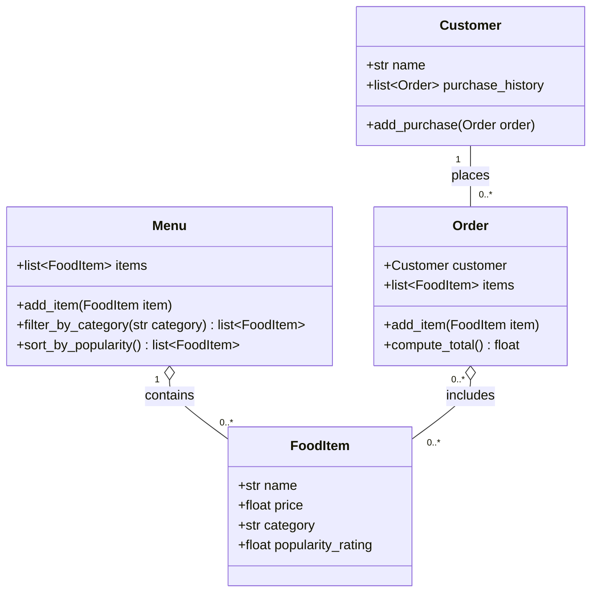

Here's the revised diagram. I followed the Behavioral Instructions in ByteBites_Design_Reference.md, which led to three changes from the last version:

is_verified() is gone. The spec says purchase history is used to verify real users but never says how, so there's no verification method until that rule is defined.
Unclear points are now questions, not assumptions. Last time I guessed at things like category matching and quantities. Those are now in the open questions below.
The None return types are gone, so the diagram is easier for beginners to read.

In Mermaid, list~Order~ means "a list of Order objects."

The classes
Customer: a person who orders food. It stores their name and a history of past orders. add_purchase() adds an order to that history.
FoodItem: one thing for sale, like a "Large Soda." It holds the four details the spec asks for and has no methods.
Menu: the single list of every item for sale. You can add items to it, filter them by category, and get a copy sorted by popularity (highest first).
Order: one transaction. It records which customer placed it and which items they picked, and it can calculate the total cost.
Relationships and multiplicities
Relationship	Meaning
Customer 1 — 0..* Order	A customer can have no orders yet, or many. Each order belongs to exactly one customer.
Menu 1 ◇— 0..* FoodItem	The one menu holds any number of items, and every item belongs to that menu. The diamond (aggregation) means the menu has the items, but each item is its own object.
Order 0..* ◇— 0..* FoodItem	An order holds any number of items, and starts empty while the customer is choosing. The same item, like "Spicy Burger," can show up in many orders.
How price changes affect purchase history
An Order doesn't copy items. It points to the same FoodItem objects the Menu holds, and compute_total() adds up each item's current price every time it runs. So if a Spicy Burger goes from $8 to $10, every past order in every customer's history that includes it will now show a total $2 higher than what the customer actually paid. Purchase history would stop being an accurate record.

There are three ways to handle this. The spec doesn't say which one the client wants:

Accept it. Totals always use current prices. This is the simplest, but past totals can change.
Have Order save its total when the order is placed. This adds one attribute and keeps past totals fixed.
Have Order save the price of each item when it's picked. This is the most accurate, but it adds the most complexity.
I left the diagram matching the spec, which only says the order should "compute the total cost." If history needs to stay accurate, option 2 is the smallest change that's still easy for beginners.

Open questions for the client
Verification: What rule decides whether a customer is a real user? Purchase history is stored, but nothing checks it yet.
Price changes: Should past orders keep the price that was actually paid? (See above.)
When an order counts as a purchase: The spec has no checkout step, so when should add_purchase() be called?
Quantities: For three sodas, should you add the same item three times, or should orders track a quantity?
Category matching: Should "drinks" match "Drinks"? Is there a fixed list of allowed categories?
Popularity rating: What scale does it use (for example 1–5 or 0–100), and what updates it?

Section 3 decisions
- Category matching is exact: "drinks" does not match "Drinks". If nothing matches, the filter returns an empty list.
- sort_by_popularity() returns a new list, highest popularity_rating first, and doesn't change the menu's own order.
- The same item can be added to an order more than once, and each copy adds its price to the total.
- Totals use each item's current price. There are no price snapshots, so a later price change also changes past order totals. This is option 1 from "How price changes affect purchase history."
- Still open: the verification rule, when add_purchase() is called, and the popularity rating scale.